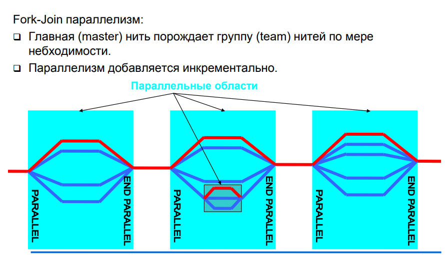
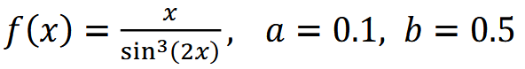

# Технологии параллелизации и оптимизации программ
---

  

## Содержание:

- [Технологии параллелизации и оптимизации программ](#технологии-параллелизации-и-оптимизации-программ)
  - [Содержание:](#содержание)
  - [LAB1 - Введение в OpenMP](#lab1---введение-в-openmp)
  - [LAB2 - Директивы и клаузы OpenMP](#lab2---директивы-и-клаузы-openmp)

## LAB1 - Введение в OpenMP

- [Папка](./Lab/Lab_1/)

---

Задание

1. Написать OpenMP программу численного интегрирования:

произвольной подинтегральной функции f();
для заданного интервала интегрирования [a; b];
методом Симпсона c равномерным разбианием интервала;
с заданной априорной точностью e = 1E-6 (правило Рунге).

  

2. Провести экспериментальный анализ масштабируемости программы при
числе процессов 2, 4, 16, 32, 64 (построить график).

3. Оформить результаты в виде отчета

---

## LAB2 - Директивы и клаузы OpenMP

- [Папка](./Lab/Lab_2/)

---

Задание

1. Написать OpenMP программу для алгоритма умножения матрицы A на вектор b:
- размер матрицы A произвольный: m - строк, n - столбцов;
- размер вектора b: n -значений;
- тип данных у матрица A и вектора b - double.
Необходимо реализовать 3 алгоритма умножения:
    1.	Ленточное разбиение по строкам с заданной шириной ленты k;
    2.	Ленточное разбиение по столбцам с заданной шириной ленты k;
    3.	Блочное разбиение с размером блока p строк на q столбцов
2. Провести экспериментальный анализ масштабируемости программы при
числе потоков 1, 2, 4, 16,  (построить график), при этом подобрать размеры матрицы, чтобы время исполнения было порядка O(1 сек).

---

<!-- ## LAB3 - Распределенная работа в OpenMP

- [Папка](./Lab/Lab_3/)

---

Задание

---

## LAB4 - Синхронизация нитей

- [Папка](./Lab/Lab_4/)

---

Задание

 -->

---
<!-- 
## LAB5 - Отладка программ c OpenMP

- [Папка](./Lab/Lab_5/)

---

Задание

---

## LAB6 - Введение в MPI

- [Папка](./Lab/Lab_6/)

---

Задание

---

## LAB7 - Реализации и начало работы с MPI

- [Папка](./Lab/Lab_7/)

---

Задание

---

## LAB8 - Двухточеченые обмены MPI

- [Папка](./Lab/Lab_8/)

---

Задание

---
## LAB9 - Коллективные обмены MPI

- [Папка](./Lab/Lab_9/)

---

Задание

---
## LAB10 - Гибридное программирование MPI+OpenMP

- [Папка](./Lab/Lab_10/)

---

Задание

---
## LAB11 - Архитектуры и метрики вычислительных устройств

- [Папка](./Lab/Lab_11/)

---

Задание

--- -->

